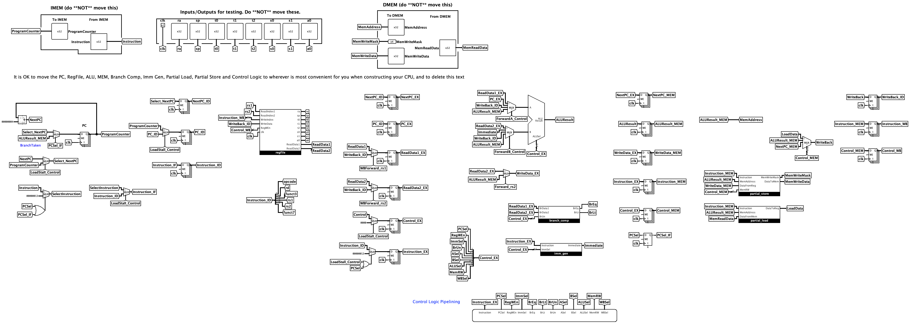
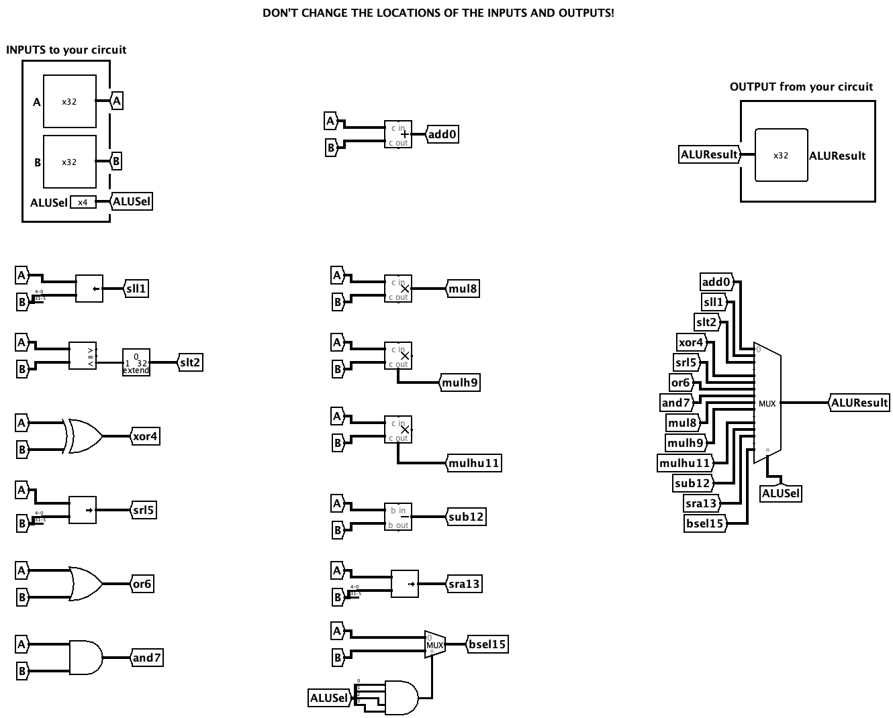
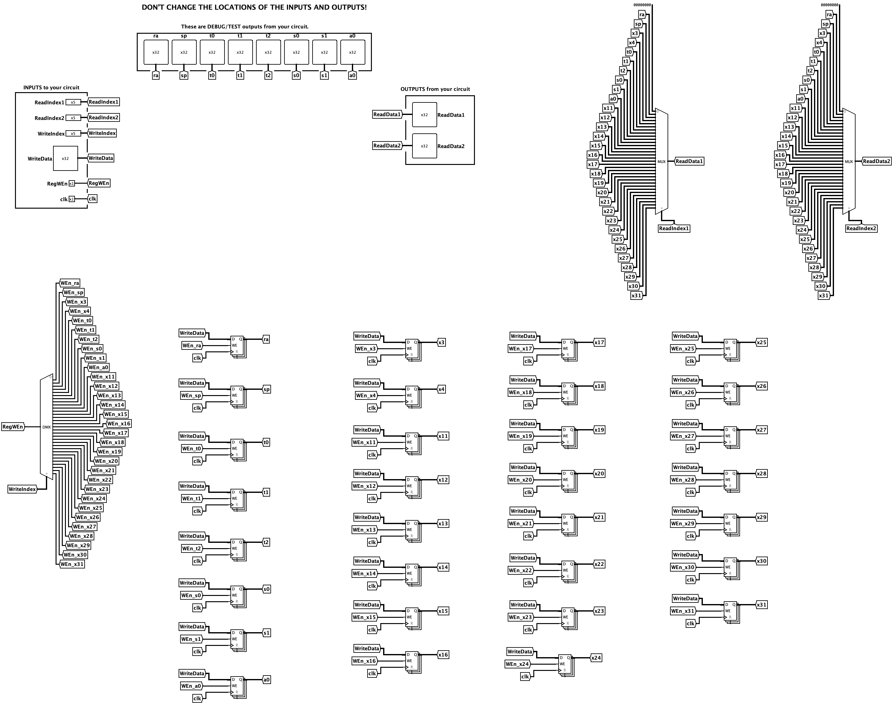
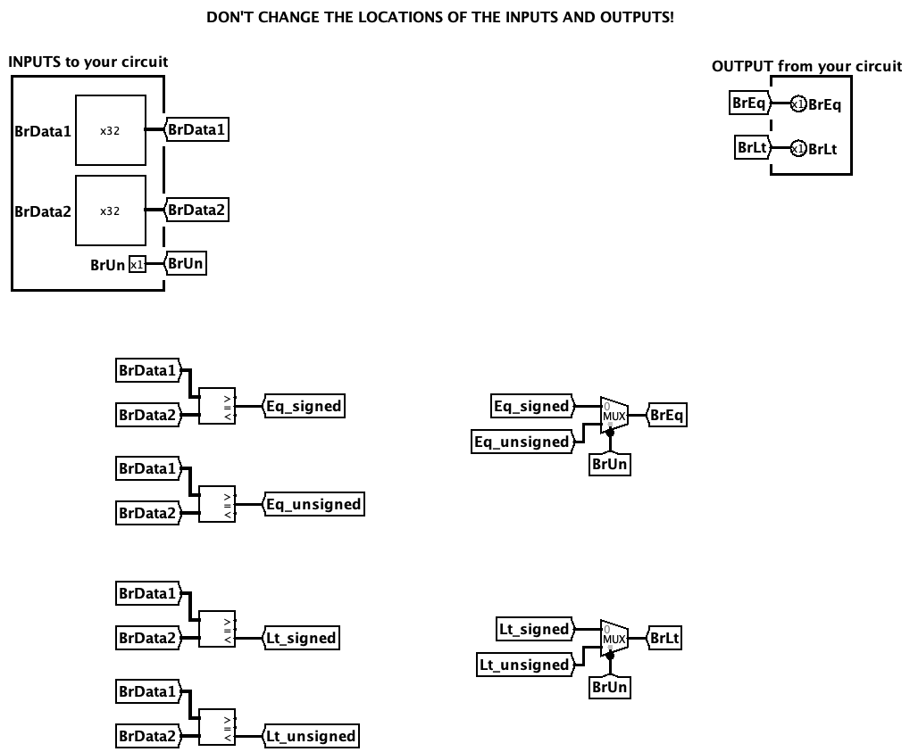
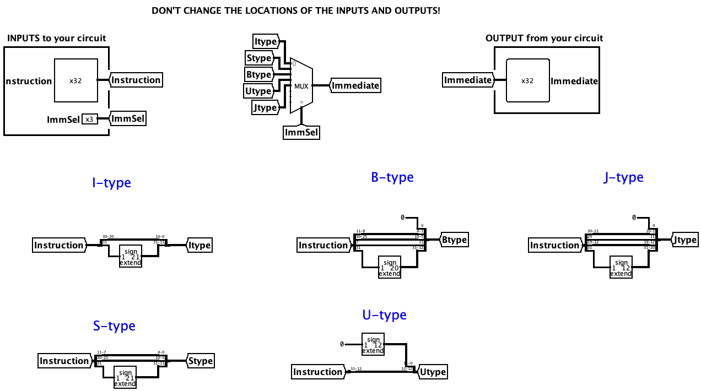
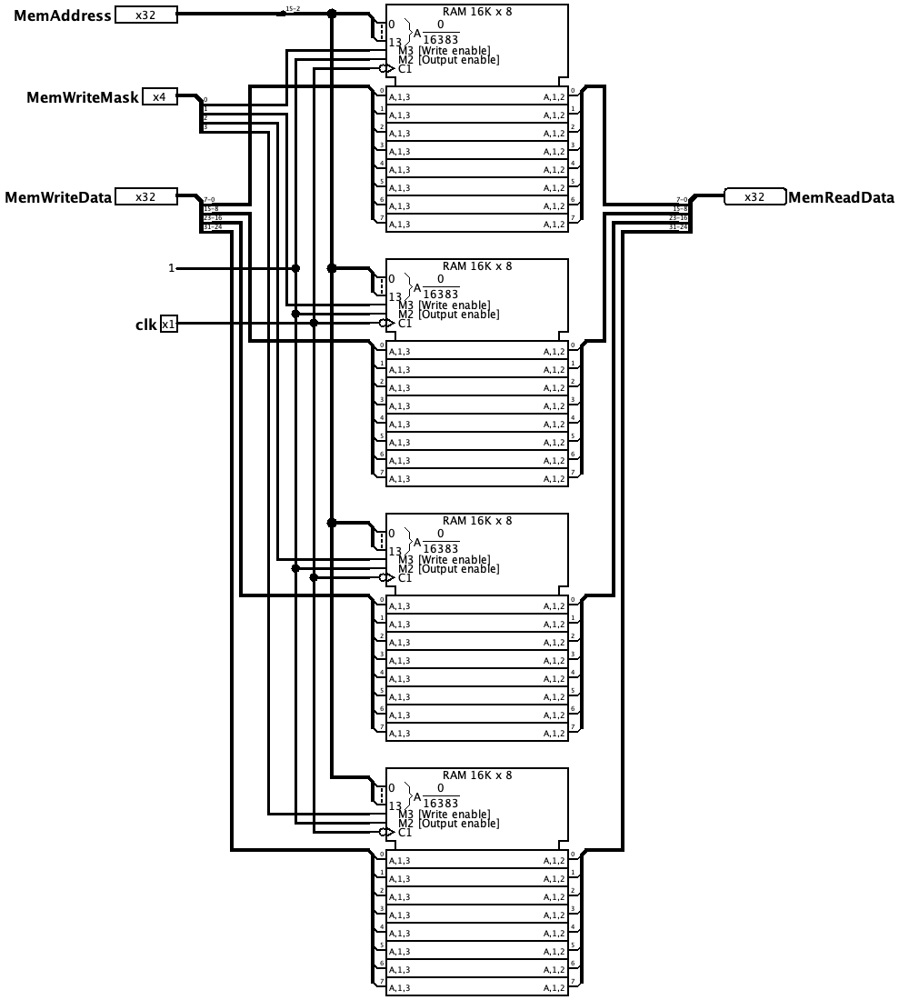
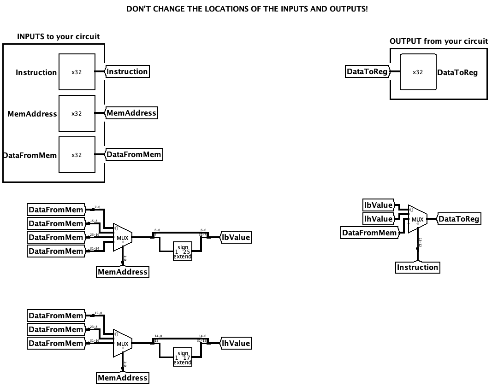
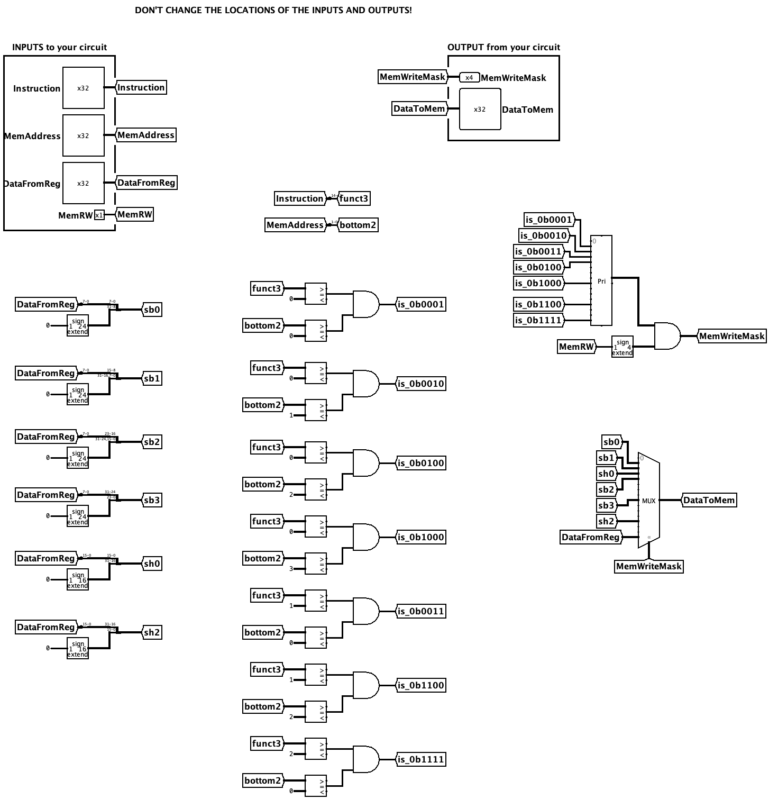

# RV32I 5-Stage Pipelined CPU

A 32-bit RISC-V (RV32I) 5-stage pipelined CPU designed and implemented using **Logisim**.

This independent computer architecture project extends my CPU design from UC Berkeley's CS61C course, expanding the original **2-stage pipelined CPU into a 5-stage pipelined architecture**.

Original CS61C project: [CS61C -> Project 3](https://github.com/TerryTang0/cs61c-self-study/tree/main/proj3) (private repo).

## Architecture

The CPU implements a classic 5-stage pipeline:

1. **IF — Instruction Fetch**
2. **ID — Instruction Decode**
3. **EX — Execute**
4. **MEM — Memory Access**
5. **WB — Write Back**

### Design Notes

**1. Data Hazards and Forwarding**

One of the main challenges in extending the original design to 5 stages was managing data dependencies between instructions and coordinating the logics.

- Implement ALU result forwarding and memory forwarding (load type) to resolve data hazards
- Implement load-use hazard detection and pipeline stalling when forwarding alone is insufficient
- Minimize unnecessary stalls to improve pipeline efficiency

**2. Control Hazards and Pipeline Flushing**

Resolve branch and jump control hazard by using NOP to flush instructions.

- Support B-type, JAL and JALR
- Implement pipeline flushing and PC redirection 

**3. Control Logic Modifications**

The original control logic skeleton provided by UC Berkeley was locked, and the output of control logic cannot be changed. Therefore, additional control logic is built in the same file as CPU circuit

- Add supplementary control logic for forwarding, stalling, and flushing
- Move the main control logic to the EX stage to align branch comparison results with branch decision
- Adjust pipeline timing to maintain correct execution across stage

## Schematics

### CPU Datapath

### Control Logic

### Supplemental Control Logic

### Arithmetic Logic Unit (ALU)

### Register File

### Branch Comparator

### Immediate Generator

### Memory

### Partial Load

### Partial Store

## Verification

The CPU was tested using custom RISC-V assembly programs and Python-based automated verification.
7/7 custom integration tests passed.

## Tools

- **Logisim Evolution** — Digital circuit design and simulation
- **RISC-V Assembly** — Instruction-level verification
- **Venus** - Simulate test files and trace program counter updates and instruction sequences.
- **Python** — Automated testing and validation
